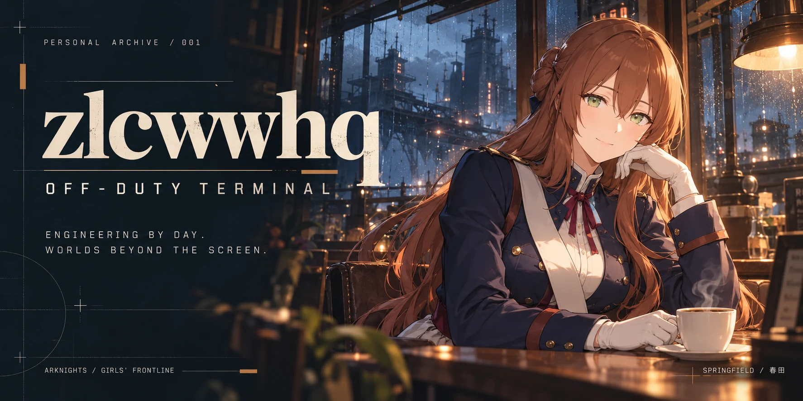
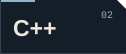
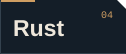
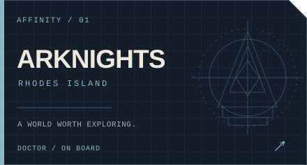
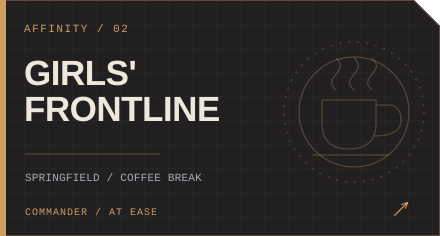
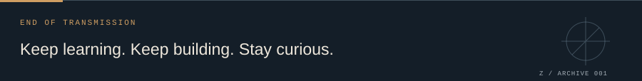

  

  <b>在代码与幻想之间，保持好奇。</b> 
  Electrical Engineering · Code · Arknights · Girls' Frontline

  

 

## 01 &nbsp; / &nbsp; Operator file

**你好，我是 zlcwwhq。** 一名热爱编程的电气工程硕士生，目前就读于 **University of Stuttgart（斯图加特大学）**。

喜欢把想法做成能运行的东西，也享受从问题里学到新东西的过程。代码之外，我的另一重身份是罗德岛的博士、格里芬的指挥官。

> An engineering mind. A love for code. A soft spot for fictional worlds.

 

## 02 &nbsp; / &nbsp; Loadout

  
  
  
  

**当前探索：Vibe Coding。** 从一句想法到一个原型，再用工程判断把它打磨得更清晰、可靠、易于维护。

IDEA → PROTOTYPE → ITERATE &nbsp; / &nbsp; 持续学习，持续构建。

 

## 03 &nbsp; / &nbsp; Off-duty worlds

  
  

**明日方舟**与**少女前线**，是我在代码之外喜欢停留的两个世界。这里也为**春田 / Springfield**留了一个位置，和一杯还冒着热气的咖啡。

 

  

欢迎来看看我的仓库。下一次灵感，也许就从一次相遇开始。

Visual notes / 视觉与素材说明

这是一份个人爱好主题主页。角色与世界观来自《少女前线》和《明日方舟》，不代表官方。

- 春田主视觉为参考角色形象制作的 **AI 生成同人插画**，并非游戏官方立绘。
- 角色外观参考：[春田角色资料](https://iopwiki.com/wiki/Springfield) · [立绘参考页](https://wikiwiki.jp/dolls-fl/スプリングフィールド)。
- 排版、技术徽章与兴趣卡片为本仓库定制 SVG；图片保存在仓库内。
- [设计说明、素材来源与生成提示词](./docs/DESIGN.md)。

